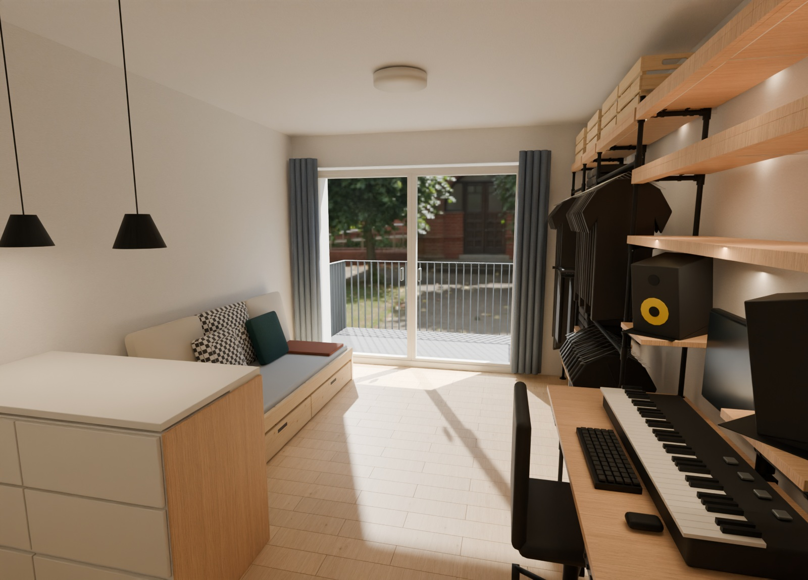

# FlatPlanning — locked V18

**Live GitHub Pages site: https://krydix.github.io/FlatPlanning/**

An interactive Three.js model of the approved studio apartment, with baked afternoon daylight (main ceiling fixture off, fixtures dimmed), an original illustrated assembly planning guide and a complete linked, priced bill of materials.

## On the site

- **Free 3D:** orbit, zoom and switch between seven room views, including the desk joints and equipment, with Cycles-baked lighting throughout camera movement. Smart cutaway retains the illuminated walls inside the apartment.
- Follow 21 illustrated stages, or inspect each stage in a 3D component viewer. All 282 frame/timber components are assigned exactly once.
- Save assembly progress and purchase checks in your browser. Nothing is sent to a server.
- Search/filter the BOM, follow supplier links and download CSV cut lists, DXF plans and the original Blender model.
- Print the complete illustrated guide and BOM using your browser’s PDF/print function.

The freely movable room uses a **128-sample Cycles bake**. Each atlas is sized from its surface area to a target texel density (about 1.5–3 mm per pixel on the frame, desk timber and equipment) and tightly packed; buried faces such as plank undersides are removed first. Atlases are baked in float and saved through the scene's own AgX view transform, so the browser shows the same graded colour as a Blender render and applies no second tone mapping. They ship as **KTX2 (UASTC + Zstandard, mipmapped)** textures, which stay GPU-compressed, with Meshopt-compressed geometry. Camera presets and hand orbit use exactly the same model, materials and cutaway rule. Inside the flat the cutaway keeps walls, ceiling and the outside view.

**Dimensions** are drawn from the data with their evidence: solid green only for site measurements, dashed amber for assumed or model-derived values. **Measure** lets you click two surfaces for a model distance. The **FOV** slider sets the horizontal field of view from 40° to 130°. The room keeps its size on screen and only the perspective changes, because the camera slides along its line of sight to compensate. Choosing a view returns to that view's framing.

The desktop's entrance-side front corner is rounded to R100. The desk module uses four DOLLE four-way threaded crosses. At desk height a cross on each middle post joins the 250 mm front arm, the 250 mm rear bridge and the post sections above and below. At 235 mm a cross on each rear post takes a 250 mm pipe from a sliding T on the middle post and a 40 mm pipe into a wall flange, replacing the old low rear brace and low wall tie. The front leg stays a plain 602 + coupling + 40 mm leg with a sliding-T brace to the middle post at 400 mm, which still sets the 665 mm kitchen-corner passage. Rear posts stack 200, cross, 1,000 + coupling + 1,000 mm. The derived desktop top is 732 mm. The €4 per-cross price is a budget allowance. Shelf positions are unchanged.

The rear equipment shelf hangs on four separate wall shelf brackets (an allowance; type and fixings not chosen), not on the pipe frame, and holds the M1 Mac mini, the router, and the router and dock power supplies. The Mac mini M1 has an internal power supply, so the third brick bay is spare. The monitor hangs on the optional desk-clamp VESA arm at the rear edge, because no stand fits behind the 61-key controller. The speaker trays are 370 mm squares inside the shelf column between the middle and rear posts, flush with the shelf fronts and mirrored about the desk centre, so nothing overhangs the desktop. Each speaker is turned on its tray to face the seated ear reference (x 2,620, z 1,220 mm); 370 mm is the smallest square that takes the turned speaker (`source/speaker_placement.py`). Angled pads tilt the speakers down. The OWC Thunderbolt 4 dock and Focusrite mount under opposite front ends with exposed controls; the 700 mm central knee width stays clear. The Equipment camera hides the chair for inspection only. Holder designs and router/brick envelopes remain provisional; their costs are allowances. A €40 allowance covers a 2 m certified Thunderbolt lead for the shown routing; reuse a suitable existing lead if available.

## Daybed

The bed is an IKEA [GLAMBERGET](https://www.ikea.com/de/de/p/glamberget-bettgestell-auszieh-aufbew-2matratz-kiefer-agotnes-fest-s89568386/) pine daybed with two ÅGOTNES 80 × 200 mattresses (€369 on 11 November 2026, still outside the budget). It stands with its long side on the left wall, from y 2,620 to 4,730 mm, with three back cushions and two accent cushions like the IKEA photos. **Extend bed** in the room viewer drops the cushions out, rolls the pull-out 825 mm into the room and raises it 170 mm on fold-down legs. **Close bed** reverses that and drops the cushions back in one by one. The **Daybed** view frames it.

- IKEA gives 211 cm long, 35 cm high, 87 cm closed and 163 cm extended. Board sizes, the stroke and the lift come from product photos. The model reaches 1,692 mm extended because its front rail sits between the mattresses.
- 211 cm does not fit between the bar and the left balcony leaf. With the daybed along the wall, that leaf opens to about 42° instead of the assumed 100° (`accepted_stop` in `source/room-measurements.json`).
- The pull-out is baked extended and the cushions in place, and neither shadows the other atlases, so nothing leaves a ghost shadow when it moves.

`scripts/update-bed.py` rebuilds the bed in `source/flat-v18.blend`. Then rebuild the portal variant and rerun the checks, data, bake and optimise steps for both layouts.

## Portal variant

A second layout sits alongside V18: pick **Portal** in the layout bar, or open `?variant=portal`. V18's model, data and guide are unchanged.

A floor-to-ceiling divider runs from the bar end to the right wall. Nothing in it is curved: straight shelves stop along an ellipse, so the Star Wars-style round door is only hinted at by where they end. Six KNAGGLIG crates sit three across and two high in the band above the door, with their heights derived from the measured ceiling.

- The opening is 1,360 mm wide and 1,990 mm high, and 869 mm wide at the floor.
- The desk module moves 950 mm along the wall as one rigid block, so its joints, speakers and equipment are exactly as in V18. Its two near posts are also the divider's rear right posts, so no upright is doubled. Those two posts run on higher than in V18, and their wall ties move to suit the divider.
- The wardrobe drops to one 602 mm short bay and one 602 mm coat bay. Folded clothes move onto the divider shelves, and the wear-again rail is gone.
- Posts stay uncut stock and stop short of the ceiling. Four sliding-T ties take up the height, so a re-measured ceiling moves the ties, crates and lintel without changing a pipe.

Inputs live in `source/portal-layout.json`. The engine reads them in `pipe_engine.build(portal=True)`. To rebuild, run these in order:

```sh
blender -b --python scripts/build-portal-variant.py
FLAT_VARIANT=portal blender -b --python scripts/check-clearances.py
python3 scripts/generate-portal-data.py
FLAT_VARIANT=portal blender -b --python scripts/bake-room.py
FLAT_VARIANT=portal node scripts/optimize-models.mjs
FLAT_VARIANT=portal blender -b --python scripts/render-room-poster.py
```

## Daylight, balcony and materials

The balcony comes from a photo and its size is assumed (`balcony` in `source/room-measurements.json`). Daylight comes from a 2K CC0 HDRI plus a sun lamp and is baked in, so sunlight and shadows do not change at runtime. The viewer shows the sky as a compressed 1.1 MB texture on a dome. Textures in `source/textures` are projected in world space, and their relief is baked through a height-based bump.

```sh
blender -b --python scripts/update-exterior.py
blender -b --python scripts/apply-materials.py
blender -b --python scripts/make-sky.py
blender -b --python scripts/build-portal-variant.py
```

Then compress `.cache/sky.png` to `public/models/sky.ktx2` with `ktx create` and rerun the bake steps for both layouts.

## Development

Requires Node.js 22.12+ (or a compatible newer version) and Python 3 for data generation/tests.

```sh
npm ci
npm run dev
```

```sh
npm run check
node --test scripts/test-viewer.mjs
python3 -m unittest discover -s source -p 'test_*.py'
npm run build
```

`docs/` contains the reproducible static build. The Pages workflow checks the data and model tests, rebuilds the site and publishes on pushes to `main`. Relative asset URLs support the `/FlatPlanning/` path.

## Source of truth

- `source/room-measurements.json`: room width, length, ceiling, services and door swings. **Only the ceiling is measured (2,630 mm, reported 23 October 2026); width, length, services and door swings are still the CAD assumption.** `scripts/update-architecture.py` fits the Blender walls and ceiling to it, and runs the floors under the walls and through the door openings. The pipe engine takes the right-wall plane and ceiling from here, and the clearance check flags the Blender architecture if it disagrees with a measurement.
- `source/flat-v18.blend`: the locked apartment model.
- `source/assembly.json`: checked component graph, stock lengths and preview fitting profile.
- `source/pipe_engine.py`: connection rules and shared desk-frame design.
- `source/equipment-layout.json`: measured M1 case size, provisional equipment/mount clearances, desk items, monitor arm and speaker envelopes.
- `scripts/check-clearances.py`: Blender clash and clearance report (`public/data/clearances.json`). It covers the entrance passage, equipment intersections, the knee zone, speaker aim, storage-to-ceiling, the pull-out under the daybed rail, door sweeps and the aisle beside the extended bed, and records the basis of each value.
- `source/prices.json`: dated hardware prices and timber/fixing allowances.
- `scripts/generate-data.py`: BOM reconciliation, assembly-stage assignment and original SVG illustrations.
- `scripts/update-desk-joints.py`: rebuild the corrected frame from the stock-pipe graph in Blender.
- `scripts/update-joint-drawings.py`: refresh the matching DXF graph layers.
- `scripts/bake-room.py`: Blender 5.2 bake/export pipeline, preserving the practical lights with the ceiling fixture off.
- `public/data/bake-manifest.json`: bake settings and asset records.
- `scripts/optimize-models.mjs`: Meshopt geometry and KTX2 texture compression for the browser asset. It needs [KTX-Software](https://github.com/KhronosGroup/KTX-Software/releases) 4.3+ (`ktx`, or set `KTX_BIN`).

After changing the locked source, regenerate with:

```sh
# Run scripts/update-architecture.py, then scripts/update-desk-joints.py, with Blender if the room file, frame graph or equipment changes.
# Then run scripts/check-clearances.py with Blender to refresh public/data/clearances.json.
python3 scripts/generate-data.py
# Run scripts/bake-room.py with Blender 5.2 in background mode.
node scripts/optimize-models.mjs
npm run check
npm run build
```

## Planning limits

V18 is a locked layout, not a structural fabrication approval. The ceiling is measured at 2,630 mm, so the four top crates clear it by 162 mm and can be tilted in. Room width and length, the services (sockets, switches, radiators, pipes), the door swing directions and the connector seating offsets are still unmeasured; fill in `source/room-measurements.json` and `source/Measurements-v8.json`. Clamp anti-rotation, shelf-holder screws, wall anchors, tabletop stiffness and actual equipment loads need verification before building. Timber sizes, bores and light-pocket details are provisional. The bathroom is a shell because its fixtures are unknown.

Core working estimate: **€2,930.73**, including a 10% reserve. With the six KNAGGLIG crates and corresponding reserve: **€2,996.66**. Without wood: **€1,778.01**, including a recalculated 10% reserve; excludes boards, timber waste and light covers, while retaining machining/fixings. Add the actual reclaimed-wood cost separately. The Parts & budget page shows every category subtotal and the filtered-table subtotal. Price basis: 19–20 October 2026; store stock and final prices must be checked. Bed, entrance furniture, installation labour and new electronics are excluded.


