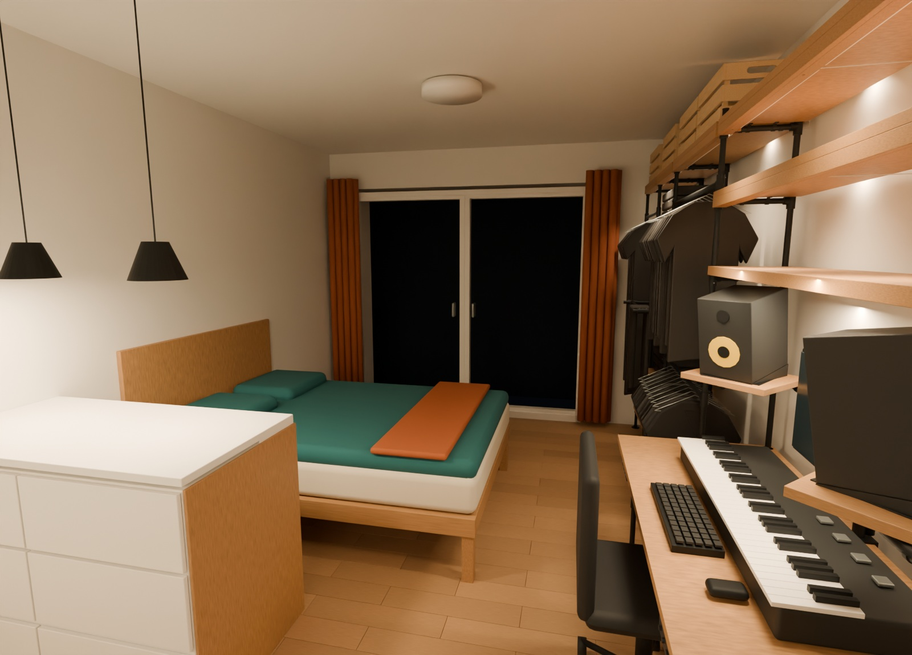

# FlatPlanning — locked V18

**Live GitHub Pages site: https://krydix.github.io/FlatPlanning/**

An interactive Three.js model of the approved studio apartment, with baked practical night lighting (main ceiling fixture off), an original illustrated assembly planning guide and a complete linked, priced bill of materials.

## On the site

- **Free 3D:** orbit, zoom and switch between five room views, with Cycles-baked lighting throughout camera movement. Smart cutaway retains the illuminated walls inside the apartment.
- **Cycles 360°:** look around full-quality Blender renders from the entrance, workstation and wardrobe. These are fixed viewing positions, with the original materials, reflections and colour treatment.
- Follow 21 illustrated stages, or inspect each stage in a 3D component viewer. All 270 frame/timber components are assigned exactly once.
- Save assembly progress and purchase checks in your browser. Nothing is sent to a server.
- Search/filter the BOM, follow supplier links and download CSV cut lists, DXF plans and the original Blender model.
- Print the complete illustrated guide and BOM using your browser’s PDF/print function.

The freely movable room uses a **128-sample Cycles bake**, with UV atlases up to **4096 × 4096**. Direct light, indirect bounce, emission and diffuse colour are stored in the textures, exported as unlit glTF and compressed with Meshopt. Camera presets and hand orbit use exactly the same model, materials and cutaway rule. They do not switch lighting systems.

For the closest match to an offline Cycles render, choose **Cycles 360°**. Each **6144 × 3072 panorama** is rendered in Cycles at **256 samples**, denoised, and saved with Blender’s display colour transform. The browser displays it without additional lighting or tone mapping. This preserves the render’s reflective materials and full lighting appearance, but movement is limited to looking around each fixed position. Free 3D remains available for arbitrary viewpoints and dimensions. The main ceiling light stays off in both modes.

## Development

Requires Node.js 22.12+ (or a compatible newer version) and Python 3 for data generation/tests.

```sh
npm ci
npm run dev
```

```sh
npm run check
node --test scripts/test-viewer.mjs
python3 -m unittest discover -s source -p 'test_*.py'
npm run build
```

`docs/` contains the reproducible static build. The Pages workflow checks the data and model tests, rebuilds the site and publishes on pushes to `main`. Relative asset URLs support the `/FlatPlanning/` path.

## Source of truth

- `source/flat-v18.blend`: the locked apartment model.
- `source/assembly.json`: checked component graph, stock lengths and preview fitting profile.
- `source/pipe_engine.py`: connection rules and shared desk-frame design.
- `source/prices.json`: dated hardware prices and timber/fixing allowances.
- `scripts/generate-data.py`: BOM reconciliation, assembly-stage assignment and original SVG illustrations.
- `scripts/bake-room.py`: Blender 5.2 bake/export pipeline, preserving the practical lights with the ceiling fixture off.
- `scripts/render-panoramas.py`: full-material Cycles equirectangular renders and their provenance manifest.
- `scripts/prepare-panoramas.py`: removes local-path JPEG comments without recompressing the rendered pixels.
- `public/data/bake-manifest.json` and `public/data/panoramas.json`: bake/render settings and asset records.
- `scripts/optimize-models.mjs`: Meshopt compression for the browser asset.

Smaller devices cap uploaded texture sizes to reduce GPU memory use; the original 6K panorama files remain available in the repository.

After changing the locked source, regenerate with:

```sh
python3 scripts/generate-data.py
# Run scripts/bake-room.py with Blender 5.2 in background mode.
# Then run scripts/render-panoramas.py with Blender 5.2 in background mode.
node scripts/optimize-models.mjs
npm run check
npm run build
```

## Planning limits

V18 is a locked layout, not a structural fabrication approval. Room height and connector seating offsets are unmeasured. Clamp anti-rotation, shelf-holder screws, wall anchors, tabletop stiffness and actual equipment loads need verification before building. Timber sizes, bores and light-pocket details are provisional. The bathroom is a shell because its fixtures are unknown.

Core working estimate: **€2,751.61**, including a 10% reserve. With the six KNAGGLIG crates and corresponding reserve: **€2,817.54**. Price basis: 19–20 October 2026; store stock and final prices must be checked. Bed, entrance furniture, installation labour and new electronics are excluded.


